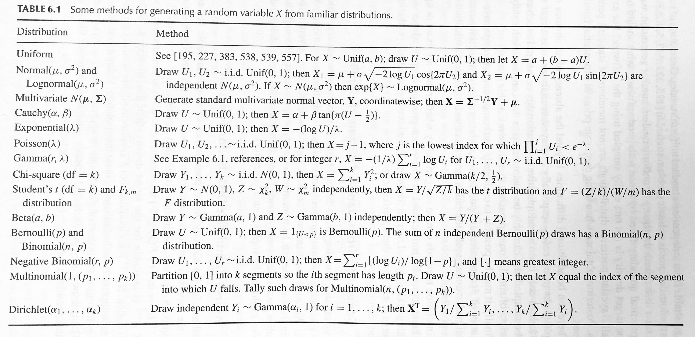

## Review and set-up

We can make random draws from common distributions (e.g. beta) using software directly (e.g. `rbeta`).

Generating from common distributions can usually be done using **transformation**, which usually only requires drawing from uniform (0,1). See table below from *Computational Statistics* (Givens and Hoeting, 2013).

## Review and set-up

Recall, in general, the distribution of a (continuous) random variable $X$ can be specified by its **probability density function** $f(x)$. In many cases we want to sample from this **target distribution**.

 
 

Challenges:

- $f(x)$ is not a standard parametric distribution
- $f(x)$ is only known up to a constant (and the constant is hard to calculate)
- $f(x)$ is computationally expensive to evaluate

Many algorithms exist to tackle these challenges and allow sampling from a general target density $f(x)$; the distribution of the resulting sample can be **exactly** $f(x)$ (e.g., acceptance-rejection sampling) or **approximately** $f(x)$ (e.g., SIR algorithm).

# Acceptance-rejection sampling

## “Accept with probability ...”

Many simulation methods involve an **acceptance-rejection** step. Suppose your goal is to simulate some data $\{x_1, x_2, \ldots x_{nsim}\}$. Key idea of acceptance-rejection:

- Make a **proposal** $x'$
- Calculate the **acceptance probability** $p(x')$
- **Accept $x'$ with probability (w.p.) $p(x')$**; reject it with probability $1-p(x')$

Q: How do you write code to “accept with probability $p(x')$”?

## Simulating from a random distribution

_Ingredients_:

- **i. Target** density: $f(x)$
- **ii. Proposal** density that is easy to sample from: $g(x)$, satisfying $f(x) \le C \cdot g(x)$ for all $x$ and some positive constant $C$. You can think of $C \cdot g(X)$ as an **envelope**.

_Algorithm_:

- **Step 1:** Sample $x'$ from $g(x)$
- **Step 2:** Sample $u$ from uniform $(0,1)$
- **Step 3:** If $u < f(x')/(Cg(x'))$, accept $x'$; otherwise reject $x'$.

_Example_:

## Exercise

Our goal is to sample from the density function: $f(x) = 6x(1-x), 0<x<1$.

1. Discussion: sketch this function (on paper or on the computer) and come up with a proposal density.
2. Implement the acceptance-rejection algorithm for a total of $nsim=10000$ updates.
3. Calculate the mean of the resulting random draws (should be close to $0.5$).
4. Plot a histogram of the resulting random draws (should be close to the functional form of $f(x)$, which is actually the density of a beta distribution with shape parameters 2, 2).
5. Calculate the *acceptance rate*.
6. Redo the sampling with a different envelope; compare the acceptance rate.

**Note: The larger the value of $C$, the less efficient the algorithm is. The acceptance rate is expected to be $1/C$.**

# Importance Sampling and SIR

## Introduction

Suppose we want to estimate the **probability of rolling a 1** of a fair dice using simulation:

- Sample from the target distribution: $1, 3, 3, 2, 5, 6, 6, 1, 2, 3, 4, 4, \ldots$
- Calculate the proportion of 1's in the sample

Alternatively, since the value of 1 is more “important" for our estimate, we want to **oversample** this value, and then correct for the oversampling bias:

- Sample from another dice where the values 2 and 3 are also recorded as 1: $5, 1, 6, 1, 4, 1, 6, 1, 4, 1, 1, 1, \ldots$
- Calculate the proportion of 1's in the sample
- Multiply the proportion by $1/3$

Why? The estimate we obtained from the second method has less variation!

## Introduction

**Importance sampling** is a general _variance reduction technique_ when we use random samples to perform some statistical inference (e.g. estimating $P(1)$).

- The alternative distribution (e.g., new dice with values 2 and 3 replaced by 1) is called an **importance sampling function** $g(x)$ (more specifically, $g(x)$ is the density of this distribution)
- The correcting multiplier (e.g., 1/3) is called the **importance weight**; it is calculated as $f(\cdot)/g(\cdot)$

## Sampling importance resampling (SIR)

**The sampling importance resampling (SIR)** algorithm is an algorithm that generates *approximate* samples from a target distribution $f(x)$, based upon the notion of importance sampling.

_Ingredients_:

- **i. Target** density: $f(x)$
- **ii. Importance sampling function** $g(x)$; the range of $g(x)$ must include the entire range of $f(x)$, and $g(x)$ must have heavier tails than $f(x)$.

_Algorithm_:

- **Step 1:** Sample $y_1, \ldots, y_m$ from $g(x)$
- **Step 2:** Calculate the importance weights $w_i, \ldots, w_m$, where $w_i = f(y_i) / g(y_i)$
- **Step 3:** Resample $x_1, \ldots, x_n$ from $y_1, \ldots, y_m$ with replacement, with probabilities $w_1, \ldots , w_m$.

## Exercise

Use SIR to redo the previous exercise, where the goal is to sample from the density function: $f(x) = 6x(1-x), 0<x<1$.

1. Use a uniform importance sampling function to sample 10000 values from the target.

      - Note 1: To obtain a target of 10000 resampled values, how many values should we generate in the first step? It is recommended that **$m \ge 10\cdot n$** (*Computational Statistics*, Givens and Hoeting).
      - Note 2: you can standardize the importance weights so that they add up to 1, but this is not required when using the R function **sample( )**.

2. Double check the random draws: calculate the mean (should be close to $0.5$); plot a histogram (should be close to $f(x)$).
3. Redo the sampling with a normal distribution importance sampling function.
