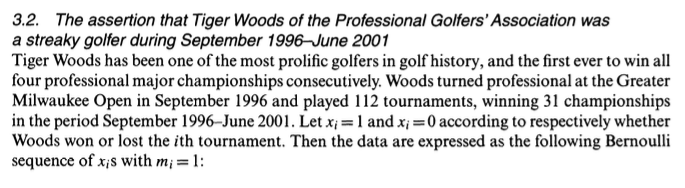
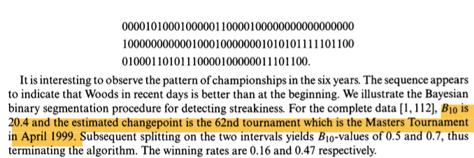

# Streakiness

## Project one: fencing


## Project two: [game of n!àì](https://www.journalofexpertise.org/articles/volume6_issue4_and_volume7_issue1/JoE_6_4_7_1_Lu_etal.html)

{width=50%}
{width=50%}


## Streak

- In both projects, data is binary (e.g.: win, win, win, lose, lose, win), and a goal is to quantify "streakiness"

- One solution ([Bayesian Binary Segmentation Procedure for Detecting Streakiness in Sports](https://rss.onlinelibrary.wiley.com/doi/full/10.1111/j.1467-985X.2004.00484.x)): calculate a statistic called <span style="color: red;">$B_{10}$</span>.  Data is considered <span style="color: red;">streaky if $B_{10} > 1$</span>





- Try: run the [sample code](../code/L8_code.R); enter a sequence of binary data and report your <span style="color: red;">$B_{10}$</span> value; is your data considered streaky?


## Data can be due to random chance
$B_{10}$ is a statistic (i.e., it's calculated based on data). We need to evaluate its **statistical significance** by looking at p-values or confidence intervals.

- If I **randomly** generate a data sequence (not streaky), is it possible that I get a $B_{10}$ value greater than 1 (streaky) just by luck?

- Idea: Say $B_{10} = 1.35$ for my actual data.  I will <span style="color: red;">randomly sample none-streaky data</span> and get their $B_{10}$ values to see if $1.35$ is considered extreme.

<div style="height: 65pt;"></div>


## Exercise
Write code to randomly sample none-streaky data (consider randomly flipping a coin)

```{r,echo=F, message=F, warning=FALSE}
#----------------------------------------------------------------------------#
#  M = integer
#  returns log(factorial(M))
#----------------------------------------------------------------------------#
f.logfac=function(M){
  result = ifelse(M==0,0,sum(log(c(1:M))))
  return(result)
}

#----------------------------------------------------------------------------#
# calculate (**) = [data | M1= 1-cut-point-model, C=c] for a specific cut point c
#  x = data vector, each value is 0 or 1
#  c = integer between 1 to length(x)-1
#  returns a numeric value 
#----------------------------------------------------------------------------#
f.likelihoodM1=function(x,c=1){
  if(length(x)==1){
    return(0)
  }else{
    result=f.logfac(sum(x[1:c])) + f.logfac(c-sum(x[1:c])) + 
      f.logfac(sum(x[(c+1):length(x)])) + 
      f.logfac(length(x)-c-sum(x[(c+1):length(x)])) -
      f.logfac((c+1)) - 
      f.logfac(length(x)-c+1)
    
    return(exp(result))
  }
}

#----------------------------------------------------------------------------#
# calculate Bayes factor (B10)
#  x = data vector, each value is 0 or 1
#  returns a numeric value 
#----------------------------------------------------------------------------#
f.B10=function(x){
  if(length(x)==1){
    return(0)
  }else{
    LC=rep(NA,(length(x)-1))
    for(c in 1:length(LC)){
      LC[c]=f.likelihoodM1(x,c)
    }
    
    LM1 = mean(LC)
    LM0 = exp(f.logfac(sum(x)) + f.logfac(length(x)-sum(x)) - f.logfac(length(x)+1))
    return(LM1/LM0)
  }
}


#----------------------------------------------------------------------------#
# estimate break point C
# x = data vector, each value is 0 or 1
# returns a numeric value 
#----------------------------------------------------------------------------#
f.c=function(x){
  LC=rep(NA,(length(x)-1))
  for(c in 1:length(LC)){
    LC[c]=f.likelihoodM1(x,c)
  }
  
  return(sum(LC*c(1:length(LC)))/sum(LC))
}


library(dplyr)
mydata.string = "1111010101000011"
mydata = strsplit(mydata.string,'') %>% unlist() %>% as.numeric()
```

- My actual data and its $B_{10}$ value:

```{r,eval=T, echo=T}
mydata
f.B10(mydata)
```

- Randomly sample none-streaky data:

```{r,eval=F}
newdata <- sample(c(0,1),
                 size=              ,
                 replace=T,
                 prob =                      )
f.B10(newdata)
```

## Hypothesis testing
- Null hypothesis $H_0$: data is not streaky
- Alternative hypothesis $H_1$: data is streaky
- Test statistic: $B_{10}$
- Reference distribution: <span style="color: red;">If the null hypothesis is true (i.e., NOT streaky)</span>, what is the distribution of the test statistic $B_{10}$?

Exercise: Run a simulation (1000 times) to estimate the reference distribution: i.e., repeat the previous step 1000 times and record the $B_{10}$ value each time.


```{r,echo=F,fig.width=8,fig.height=3.5,out.width = '95%'}
#----------------------------------------------------------------------------#
# empirical p-value
#----------------------------------------------------------------------------#
nsim = 1000
result = rep(NA,nsim)

set.seed(1)
for(i in 1:nsim){
  newdata = sample(c(0,1),size=length(mydata),replace=T,prob = c(1-mean(mydata),mean(mydata)))
  result[i] = f.B10(newdata)
}


# visualize
hist(result,nclass = 100,
     main='B10 value of simulated data with NO streakiness',
     col='royalblue',xlab=NA)
abline(v=f.B10(mydata),col='red',lwd=2)
```


## Empirical p-value 

- <span style="color: red;">p-value</span>: probability that the test statistic is as extreme, or more extreme, than the observed value, under the null hypothesis ("extreme" in the sense of pointing to the alternative hypothesis).

<div style="height: 30pt;"></div>

- Formula for calculating the p-value based on simulation has a small adjustment ([A note on the calculation of empirical p-values from Monte Carlo procedures](https://pmc.ncbi.nlm.nih.gov/articles/PMC379178/))


<div style="height: 30pt;"></div>

- The empirical p-value is calculated as:

```{r}
(sum(result>=f.B10(mydata)) + 1)/(nsim + 1)
```


# Lady tasting tea

## Introduction
A classic example in statistics, due to R. A. Fisher: [lady tasting tea](https://en.wikipedia.org/wiki/Lady_tasting_tea)

<ul>
<li>T: adding tea first; M: adding milk first</li>
<li>A lady claims that she can tell the difference by tasting</li>
<li>8 cups are prepared: T T T T M M M M</li>
<li>The lady is asked to pick out 4 that she believes was made by adding tea first</li>
</ul>

Out of the 4 she picks, how many needs to be correct for you to believe that she actually has the ability to tell the difference?
<div style="height: 50pt;"></div>


## Hypothesis test
- Null hypothesis $H_0$: The lady is just guessing (i.e., cannot tell the difference)
- Alternative hypothesis $H_1$: The lady can tell the difference
- Test statistic: X = the number she gets correct (Q: what's the range of X?)
- Reference distribution: <span style="color: red;">If the null hypothesis is true (i.e., she is only guessing)</span>, what is the distribution of the test statistic X?


## Simulation
```{r}
tea <- c('T','T','T','T','M','M','M','M')
choice <- sample(tea,size=4,replace=F); choice

nsim<-10000
result <- rep(NA,nsim)
for(i in 1:nsim){
  choice<-sample(tea,size=4,replace=F)
  result[i]<-sum(choice=='T')
}
table(result)
```

- If she guessed 4 out of 4 correct, the p-value is: 
<div style="height: 10pt;"></div>

- If she guessed 3 out of 4 correct, the p-value is: 
<div style="height: 10pt;"></div>


## Discussions

- In the "lady tasting tea" and SES examples (see [homework 8](../homework/homework_8.qmd)), the reference distribution is easy to derive mathematically. Simulation is more useful with difficult test statistics (like $B_{10}$).

- For the lady tasting tea example, if she gets 4 out of 4 correct, we would reject the null and conclude that "we have enough evidence that she is not guessing."  This DOES NOT *prove* that she is *definitely* not guessing.  All we are saying is that "it's difficult to get 4 out of 4 correct just by random chance."

- ...if she gets 3 out of 4 correct, we would "accept" the null and conclude that "she is guessing."  This DOES NOT *prove* that she is *definitely* guessing.  All we are saying is that "it's very possible to get 3 out of 4 correct just by random chance."

- <span style="color: red;">Monte Carlo methods</span> refer to a very broad class of methods that rely on using <span style="color: red;">random sampling</span> to solve otherwise difficult problems (example: bootstrapping, Monte Carlo integration, empirical p-value).

