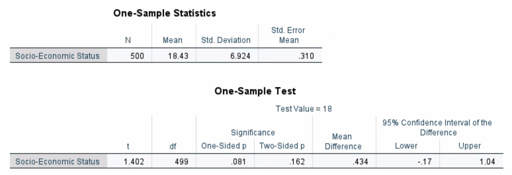

<!-- do not alter this first chunk below  -->
```{r setup, include = FALSE}
knitr::opts_chunk$set(echo = TRUE)
```


<!--


1. This question is related to the measure of streakiness that we did in class.  You can find sample code linked on Moodle.

    a. Write down a sequence of binary data that is meaningful to you (e.g., in class, I briefly showed you the seasonal record of Phoenix Suns, and the recorded data was given in the sample code).  If your sequence is based on real data, provide a link of your data source.  If your sequence is made-up, briefly discuss your reasoning (e.g., "this represents an extreme case of very streaky data.")
    
    b. For the sequence in (a), use the sample code to obtain the $B_{10}$ value.  Recall that if $B_{10}>1$, your data is considered streaky.  Is your data streaky based on this criteria?
    
    c. We should not draw a conclusion only based on $B_{10}$ since this value, calculated from data, could be due to random chance.  To that end, perform a simulation and report the empirical p-value for $B_{10}$.  Draw a conclusion based on the p-value.
    

2. This question is based on the SES example in the lecture slide.  In a certain population, the SES (social-economic score) follows a *normal* distribution with mean$=\mu$ (unknown) and SD$=6.9$.  We want to test if $\mu$ is significantly higher than 18.  In this case, the null hypothesis is $\mu=18$ and the alternative hypothesis is $\mu > 18$.  For the data, you conduct a survey of $n=500$ participants and record their SES scores.  The sample mean is $\bar{X} = 18.43$, with a sample standard deviation $s=6.924$. 

    a. The test statistics is calculated as $t = \frac{\bar{X} - 18}{s/\sqrt{500}}$.  Calculate the observed test statistic based on your data (i.e., you just need to plug in the values of $\bar{X}$ and s).
    
    b. If the null hypothesis is true ($\mu=18$), what is the distribution of the test statistic t?  Recall that this is called the reference distribution.  Carry out a simulation as follows: randomly sample $n=500$ SES scores from a normal distribution with mean $\mu=18$ and SD$=6.9$ (i.e., this is the distribution under the null hypothesis); calculate the test statistic value t as defined in (a) (hint: you need to calculate the sample mean and sample SD based on your simulated data); repeat for a large number of times, recording the value of t each time.  Plot a histogram of the 10000 simulated t values as an estimate of the reference distribution.
    
    c. Based on your histogram, comment on whether the actual observed value of t in (a) is considered ``unusual."  What is the p-value of this hypothesis testing?  Draw a conclusion based on the p-value.


3. Suppose you flip a coin for 10 times and get HHHTHHHHTH.  Do you think we have enough evidence to say that this is a biased coin?  In this case, the null hypothesis is that the coin is not biased (i.e., $P(head) = 0.5)$), and the alternative hypothesis is that the coin is head-biased (i.e.,$P(head) > 0.5$).  The test statistic is the number of heads out of 10 flips.

    a. What is the reference distribution in this case?  You can either specify the exact distribution, or use a simulation to estimate the distribution.
    
    b. What is the empirical p-value for the data HHHTHHHHTH?  What is the conclusion based on the p-value?


4. In an experiment, researchers test if drinking beer attracts mosquitoes\footnote{Beer Consumption Increases Human Attractiveness to Malaria Mosquitoes, Lefvre, T., et. al., PLoS ONE, 2010; 5(3): e9546.}.  Participants were randomly assigned to two groups: 25 participants drank a liter of beer; 18 participants drank a liter of water.  Mosquitoes were caught in traps as they approached the participants.  The number of mosquitoes of the two groups are provided below.

```{r}
beer=c(27,20,21,26,27,31,24,19,23,24,28,19,24,29,20,17,31,20,25,28,21,27,21,18,20)            
water=c(21,22,15,12,21,16,19,15,24,19,23,13,22,20,24,18,20,22)
```

The null hypothesis is that there is no difference between the two groups, and the alternative hypothesis is that drinking beer attracts mosquitoes.  From the data, we see that, on average, the beer group attracts 4.38 more mosquitoes than the water group. This mean difference is our test statistic.

```{r}
mean(beer) - mean(water)
```

a. To estimate the reference distribution, we will simulate the test statistic under the null hypothesis (no difference) as follows: gather the 43 data values from both groups and re-randomize (without replacement) the values into Beer and Water groups (sample sizes remain the same).  Calculate the new mean difference after re-randomization.  Repeat for nsim=10000 times, recording the mean difference each time.  Plot a histogram of the 10000 simulated mean differences as an estimate of the reference distribution.
    
b. Based on your histogram, comment on whether the actual observed mean difference (4.38) is considered ``unusual."  What is the p-value of this hypothesis testing?  Draw a conclusion based on the p-value.


# One-sample t test

## Introduction
In a certain population, the SES (social-economic score) follows a *normal* distribution with mean$=\mu$ and SD$=6.9$ (estimated).  We want to test if $\mu$ is significantly higher than 18.

- Null hypothesis: $\mu=18$
- Alternative hypothesis: $\mu > 18$
- Data: randomly sample 500 people from the population, record their SES scores, and calculate the sample mean (**xbar**) and sample SD (**s**)
- Test statistic: $t = \frac{\textbf{xbar} - 18}{\textbf{s}/\sqrt{500}}$
- Reference distribution: if the null hypothesis is true, what is the distribution of the test statistic? Run a simulation to find out.
<div style="height: 80pt;"></div>


##

```{r}
#| echo: true
#| code-fold: true
#| code-summary: "Show code"
#| out-width: "50%"
#| fig-height: 3
#| fig-width: 5
#-------------------------------------------#
# One sample t test SES example
#-------------------------------------------#
nsim <- 10000
result <- rep(NA,nsim)
for(i in 1:nsim){
  mysample <- rnorm(500, mean=18, sd=6.9)
  result[i] <- (mean(mysample) - 18)/(sd(mysample)/sqrt(500))
}

hist(result,probability = T, main='Reference distribution',
     xlab='Simulated t values') # simulated distribution
curve(dt(x,df=499),add=T,col='red') #true distribution


# empirical p-value
# (sum(result>=1.402) + 1)/(nsim + 1)
```

- Suppose you have conducted this survey and the data you collected gives an **xbar** value of $18.43$ and an **s** value of $6.924$

- What is the test statistic value based on your data?
<div style="height: 20pt;"></div>

- Is the test statistic value extreme?  What's the p-value?
<div style="height: 20pt;"></div>


##


-->