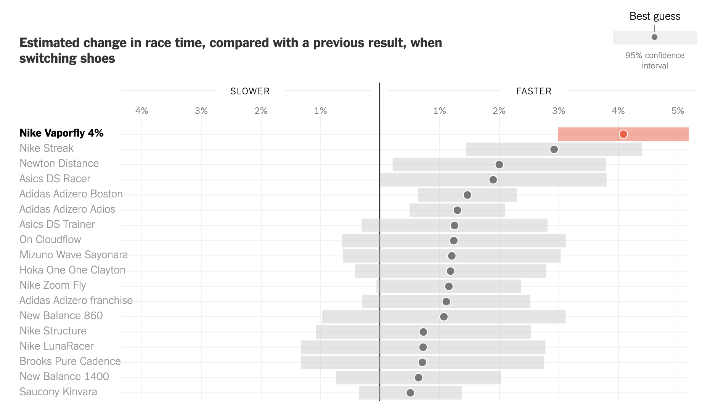

# Confidence intervals

## Example: movie lengths

Treat the `Combined Class Movies` dataset as a **random sample** of all movies. The variable `TOTALLENGTHMINS` is the length of each movie in minutes.

- Population:

- Population mean:

- Sample:

- Sample mean:

- Point estimate for the population mean:

- Interval estimate for the population mean:

Show Jamovi table

| Statistic | `TOTALLENGTHMINS` |
|:--|--:|
| N | 100 |
| Missing | 0 |
| Mean | 114 |
| 95% CI mean lower bound | 110 |
| 95% CI mean upper bound | 118 |
| Median | 115 |
| Standard deviation | 19.2 |
| Minimum | 80.0 |
| Maximum | 169 |

> **Jamovi procedure:** **Analyses > Exploration > Descriptives**. Select **Confidence intervals** under **Statistics > Mean Dispersion**. The confidence level can also be changed (default: 95%).

## Interpretation of confidence intervals

What does it mean to be “95% confident”?

- A probability statement must involve something **random**. In this case, where does the randomness come from?
- Imagine collecting another random sample of 100 movies and constructing a 95% confidence interval. Would it also be (110, 118) minutes?
- **Interpretation:** If we took many random samples of 100 movies and constructed many 95% confidence intervals accordingly, approximately 95% of those intervals would contain the true population mean.

## Confidence level

Construct 90% and 99% confidence intervals for the average length of all movies. Which interval is wider?

Show solution

The 90% confidence interval is (111, 117) minutes, and the 99% confidence interval is (109, 119) minutes. The 99% interval is wider than the 90% interval. Note that the sample mean, 114 minutes, is at the center of both intervals.

Compare:  am I very certain, or somewhat certain? 

- ... that movies are between 5 minutes and 6 hours long, on average.
- ... that movies are between 115 and 120 minutes long, on average.

If all else stays the same and the confidence level increases (for example, from 90% to 99%), will the interval:

a. Be wider
b. Be narrower
c. Stay the same

## Sample size

- Dataset 1: $N = 100$ movies
- Dataset 2: $N = 10000$ movies

Which sample would give a more **precise** confidence interval?

If all else stays the same and the sample size increases (for example, from $N = 100$ to $N = 10000$), will the interval:

a. Be wider
b. Be narrower
c. Stay the same

## Exercise (Combined Class Movies)

1. Construct a 95% confidence interval for the average `TOMATOMETER` score of all movies.

Read me!

Note the wording: 1. the CI is for the **average** specifically, not any other statistic like the median; 2. the CI is for the average of **all movies**. Why not "for movies in the dataset?" Because the average length of the 100 movies in the dataset is exactly 114 min; there is no need for a confidence interval. The average length of **all movies**, in comparison, is **unknown**.

2. Construct a 99% confidence interval for the average `TOMATOMETER` score. Is it wider or narrower than the 95% interval?
3. Construct a 95% confidence interval for the true correlation between `TOMATOMETER` and `AUDIENCEL` (audience score) among all movies. A correlation can be obtained under **Regression > Correlation Matrix**; confidence intervals are under **Additional Options**.
4. Use a regression analysis to predict `AUDIENCEL` from `TOMATOMETER`. Construct a 95% confidence interval for the slope. Regression is under **Regression > Linear Regression**; confidence intervals are under **Model Coefficients > Estimates**.

Show solution

**Solution:**

1. The 95% confidence interval is (62.7, 74); the sample mean is 68.3.
2. The 99% confidence interval is (60.8, 75.8). It is wider than the 95% interval, so it is less precise.
3. The 95% confidence interval is (0.817, 0.913); the sample correlation is 0.873.
4. The 95% confidence interval for the slope is (0.494, 0.618); the estimated slope is 0.556. For each one-point increase in `TOMATOMETER`, the predicted `AUDIENCEL` score increases by 0.556 points on average. The interval gives a plausible range for the population slope.

**Note 1:** In these examples, each **point estimate** (the sample statistic) is at or near (allowing for rounding) the center of its confidence interval. The sample mean of 68.3 is at the center of (62.7, 74) and (60.8, 75.8). The sample correlation of 0.873 is near the center of (0.817, 0.913), and the estimated slope of 0.556 is at the center of (0.494, 0.618).

**Note 2:** Confidence intervals can be constructed for a correlation coefficient, regression slope, or other parameter. In this class, we mainly focus on inferences about the **mean** (examples 1 and 2 above).

# One-sample t-test

## Hypothesis

We are making an inference about the **average** length of **all** movies. A researcher claims that the average length is 2 hours (120 minutes), and we want to test this claim.

The parameter of interest is:

Null hypothesis (denoted $H_0$): 

- the average movie length is 120 minutes

 

Alternative hypothesis (denoted $H_1$ or $H_a$):

- The average movie length differs from 120 minutes
- The average movie length is shorter than 120 minutes
- The average movie length is longer than 120 minutes

## P-value

> **Jamovi procedure:** **Analyses > T-Tests > One Sample T-Test**. Move `TOTALLENGTHMINS` into **Dependent Variables**. Under **Hypothesis**, enter `120` as the test value and select the appropriate alternative. Also select **Effect size** and **Descriptives**. (Jamovi can also provide a confidence interval for the effect size, but it is not required.)

p-value is the probability, assuming the null hypothesis is true, of observing the results or results more extreme than those in the sample (more on this later).

- If the p-value is very small (for example, less than a cut off of $\alpha = 0.05$), the result is **statistically significant** and we **reject** the null hypothesis.

- If the p-value is above the cut off, the result is not statistically significant and we "fail to reject" the null hypothesis.

Movie length example: for the one-sided alternative $\mu < 120$, the p-value is 0.002. Since $0.002 < 0.05$, we **reject the null hypothesis** and conclude that the average movie length is statistically significantly shorter than 120 minutes.

> **Important:** Remember to change the **test value**!  Jamovi's default of 0 means you are testing whether the average movie length is 0 minutes, which would lead to an extremely small p-value because we would certainly reject such a claim.

## Effect size

If a test is significant, we also want to know **by how much** the sample mean differs from the hypothesized population mean. **Effect size** is a standardized measure of that difference. (As we only care about the magnitude, you can ignore the sign.)

Cohen's $d$ guidelines for effect size magnitude:

- 0.2: small
- 0.5: moderate
- 0.8: strong

Movie length example: Cohen's $d = 0.304$, a small-to-moderate effect. The sample mean (114 minutes) is 6 minutes, or 0.304 standard deviations, below the hypothesized value of 120 minutes.

## Assumptions

For a one-sample t-test, the sampling distribution of the sample mean should be approximately normal.

- This is true if the population is normally distributed.

 

- Otherwise, the **Central Limit Theorem** says the sampling distribution becomes approximately normal when the sample size is sufficiently large.

In practice: "Sample size is large enough (>30), normality is not an issue."

Do not say "the population is normally distributed" or "normality is checked"!  In fact, you can check normality using the **Normality test** option in Jamovi, but it is not required for this class.  We do NOT need to check normality because typically the sample size is large enough for the Central Limit Theorem to apply.

(Optional) Show more

Jamovi can perform a Shapiro-Wilk test for normality. As noted, a significant result (p < 0.05) suggests the data is not normally distributed (e.g., movie lengths are expected to be right-skewed, maybe bimodal; things like family size, or income, are also often right-skewed).

**If you have a large sample size ($n \ge 30$):**. Thanks to the Central Limit Theorem, the t-test is highly robust to non-normal data as long as the sample size is large enough. One thing to note, however, is that t-test can be affected by extreme outliers and extreme heavy tails, even in large samples.

**If you have a small sample size ($n < 30$):** For small samples, the t-test relies heavily on the assumption that the underlying population data is normally distributed. If the Shapiro-Wilk test suggests a departure from normality, the results of a standard one-sample t-test may be unreliable.  You should consider alternative tests that do not rely on normality (often called "non-parametric" methods).

## Example 1: NELS expected income at age 30 (`expinc30`)

Based on `expinc30`, do people in the U.S. expect to earn more than $45,000 on average by age 30?

a. State the null and alternative hypotheses.
b. Evaluate the normality assumption, or explain why it is probably not a concern for this analysis.
c. Perform a one-sample t-test and report the p-value.
d. Draw a conclusion based on the p-value.
e. Report and interpret the effect size, or explain why it is inappropriate.

Show solution

a. Let $\mu$ be the average expected income at age 30 among the entire population. $H_0: \mu = 45{,}000$ and $H_a: \mu > 45{,}000$.
b. The sample size is large ($N = 459$), so normality is not an issue. (NELS dataset has a sample size of 500, but only 459 is used for this test due to missing values.)
c. $p = 0.008$.
d. Since $p < 0.05$, reject $H_0$. Yes, people in the U.S. do expect to earn more than $45{,}000$ on average by age 30.
e. Cohen's $d = 0.113$, a very small effect. The sample mean ($51575$) is 0.113 standard deviations higher than the hypothesized value of $45000$.

## Example 2: NELS family size (`famsize`)

Does the average family size in the U.S. exceed 4?

a. State the null and alternative hypotheses.
b. Perform a one-sample t-test and report the p-value.
c. Draw a conclusion based on the p-value.
d. Report and interpret the effect size, or explain why it is inappropriate.

Show solution

a. Let $\mu$ be the average family size. $H_0: \mu = 4$ and $H_a: \mu > 4$.
b. $p < 0.001$.
c. Since $p < 0.05$, reject $H_0$. Yes the average family size in the U.S. does exceed 4.
d. Cohen's $d = 0.525$, a moderate effect. The sample mean (4.69) is 0.525 standard deviations larger than the hypothesized value of 4.

> **Discussion:** If a researcher writes, “Study shows that people in the U.S. are having big families. The average family size is significantly bigger than 4,” what concerns might you raise about this claim?

## Using CI to perform a two-sided hypothesis test
 
For a two-sided test at the 0.05 significance level, use either the p-value or the 95% confidence interval to draw a conclusion. If the interval contains the hypothesized mean, fail to reject the null hypothesis; if it does not, reject the null hypothesis.

For example, the 95% confidence interval for average SES is approximately (17.83, 19.04). Because this interval contains the hypothesized mean of 18, we fail to reject the null hypothesis, matching the p-value conclusion.

## Example 3: NELS socioeconomic status (`ses`)

Suppose the average socioeconomic status (SES) score of students in Canada is 18. Is the average SES score of American students different from 18?

a. State the null and alternative hypotheses.
b. Evaluate the normality assumption, or explain why it is probably not a concern for this analysis.
c. Perform a one-sample t-test and report the p-value.
d. Draw a conclusion based on the p-value.
e. Report the 95% confidence interval for the average SES score of American students and draw a conclusion.
f. Report and interpret the effect size, or explain why it is inappropriate.

Show solution

a. Let $\mu$ be the average SES score of American students.  $H_0: \mu = 18$ and $H_a: \mu \ne 18$.
b. The sample size is large ($N = 500$), so normality is not an issue.
c. $p = 0.162$.
d. Since $p > 0.05$, fail to reject $H_0$.  The average SES score of American students is NOT significantly different from 18.
e. $(17.826, 19.04)$. Since it contains 18, we would "accept" a value of 18 (i.e., same conclusion as in d).
f. No need to do effect size as the test is not significant. (Intuition: we concluded that the average SES is NOT different from 18, so it makes no sense to ask "how much" of a difference there is.)

## Example 4: NELS AP courses (`apoffer`)

Is the average number of AP courses offered by a school (`apoffer`) different from 5?

a. State the null and alternative hypotheses.
b. Perform a one-sample t-test and report the p-value.
c. Draw a conclusion based on the p-value.
d. Report the 95% confidence interval for the average number of AP courses offered.
e. Draw a conclusion based on the confidence interval.
f. Report and interpret the effect size, or explain why it is inappropriate.

Show solution

a. Let $\mu$ be the average number of AP courses offered by a school. $H_0: \mu = 5$ and $H_a: \mu \ne 5$.
b. $p = 0.168$.
c. Since $p > 0.05$, fail to reject $H_0$. The average number of AP courses offered is NOT significantly different from 5.
d. $(4.821, 6.02)$.
e. The interval contains 5, so we "accept" a value of 5. Same conclusion as in c.
f. No need to do effect size as the test is not significant.

## Summary steps for one-sample t-test

1. State the null and alternative hypotheses.
2. Check the normality assumption (check sample size).
3. Draw a conclusion based on the p-value. (OR, for a two-sided test, draw a conclusion based on the confidence interval)
4. **ONLY if the test is significant**, report and interpret the effect size.

# Paired-samples t-test

## Set up and hypotheses

Previously, we make inference on the population mean, based on the sample mean.

Now: we compare TWO means of two variables from the population, and the two variables have to be paired.

NELS data screenshot

| `achrdc10` | `achrdg12` |
|--:|--:|
| 41.49 | 52.56 |
| 48.70 | 53.12 |
| 56.94 | 54.79 |
| 42.64 | 44.77 |
| 63.29 | 61.99 |
| 65.66 | 65.02 |

| `slfcnc10` | `slfcnc12` |
|--:|--:|
| 22 | 36 |
| 23 | 22 |
| 19 | 33 |
| 21 | 29 |
| 35 | 41 |
| 16 | 27 |

| `achrdg08` | `achmat08` |
|--:|--:|
| 41.94 | 47.44 |
| 53.86 | 54.49 |
| 53.06 | 58.05 |
| 41.86 | 43.09 |
| 67.97 | 64.91 |
| 62.84 | 61.04 |

Has the average reading achievement score in 12th grade decreased from 10th grade?

Has self-concept in 12th grade, on average, improved from 10th grade?

Is the average reading achievement different from the average math achievement in 8th grade? 

## Comparing the difference

We can calculate the difference between the two scores as our new “differenced data”

| `achrdg10` | `achrdg12` | Difference (12th - 10th) |
|--:|--:|--:|
| 41.49 | 52.56 | 11.07 |
| 48.70 | 53.12 | 4.42 |
| 56.94 | 54.79 | -2.15 |
| 42.64 | 44.77 | 2.13 |

Testing “Has the average reading achievement score in 12th grade decreased from 10th grade?”
	
    ... is the same as ...

Testing “Is the mean difference less than zero?”

> The math behind a paired samples t test is identical to a one-sample t-test, where the one-sample is the difference between the two paired variables. The null hypothesis is that the mean difference is zero.

## Comparing the difference

Again, the paired samples t-test is equivalent to a one-sample t-test. e.g., $H_0: \mu_{math} = \mu_{reading}$ can also be written as $H_0: \mu_d = 0$ where $\mu_d$ is $\mu_{math} - \mu_{reading}$.

- For the normality assumption, we either check that the differences are normally distributed, or we rely on the Central Limit Theorem if the sample size is sufficiently large (>30).

- For a two-sided test, we can reject the null if the confidence interval of the mean difference ($\mu_d$) does not contain zero.

Intuitive example 1: [fastest running shoes](https://www.nytimes.com/interactive/2018/07/18/upshot/nike-vaporfly-shoe-strava.html)

Each dot is the estimated change (i.e., the sample mean), each horizontal bar is its 95% confidence interval, and zero represents no change.  Confidence interval for Nike Vaporfly does not contain zero, so it shows a statistically significant improvement (at alpha = 0.05). Confidence interval for Asics DS trainer does contain zero, so it does not show a statistically significant change.

Intuitive example 2: [Young people interest](https://www.kaggle.com/datasets/miroslavsabo/young-people-survey/data)

The [young people survey](https://www.kaggle.com/datasets/miroslavsabo/young-people-survey/data) contains a set of questions that ask what young people (in Slovakia) are interested in (Likert scale, 1 = not interested, 5 = very interested). Look at the CI below, we see that young people are significantly more interested in shopping than celebrities; significantly more interested in mathematics than physics; significantly less interested in mathematics than fun with friends; and not significantly different in their interest in mathematics and law.  Note how these conclusions are consistent with the given p-values.

::: {style="width: 50%; margin: 0 auto; font-size: 50%;"}
| Measure 1 | Measure 2 | Test | Statistic | df | *p* | Mean difference | SE difference | 95% CI: Lower | 95% CI: Upper |
|:--|:--|:--|--:|--:|--:|--:|--:|--:|--:|
| Shopping | Celebrities | Student's *t* | 22.44 | 1005.00 | < .001 | 0.92 | 0.04 | 0.84 | 1.00 |
| Mathematics | Physics | Student's *t* | 7.38 | 1003.00 | < .001 | 0.27 | 0.04 | 0.20 | 0.34 |
|  | Funwithfriends | Student's *t* | -45.00 | 1002.00 | < .001 | -2.22 | 0.05 | -2.32 | -2.12 |
|  | Law | Student's *t* | 1.44 | 1005.00 | .149 | 0.08 | 0.06 | -0.03 | 0.19 |

: Paired Samples T-Test {#tbl-paired-samples-t-test}

*Note.* Two-sided alternative: $H_a: \mu_{\text{Measure 1} - \text{Measure 2}} \ne 0$.

:::

## P-value

> Jamovi procedure: **Analyses > T-Tests > Paired Samples T-Test**. Move the two variables into the **Paired Variables** box  Under **Hypothesis**, select the appropriate alternative. Also select **Effect size** and **Descriptives**.

- The order in which you put the two variables does not matter, but for one-sided alternative, the direction needs to be consistent with the choice of the alternative hypothesis. For example, if you want to test whether the average reading achievement score in 12th grade is LESS than that in 10th grade, and you put `achrdg10` first (Measure 1) and `achrdg12` second (Measure 2), the alternative should be **Measure 1 > Measure 2** and the output should say: "Note: $H_a$ $mu$(Measure 1 - Mueasure 2) > 0".

- One way to check: the correct one-sided p-value is always less than 0.5 (and half of the two-sided p-value). For example, the two-sided p-value for `achrdg12` vs `achrdg10` is 0.056, and the one-sided p-value is 0.028.

Question: Has the average reading achievement score in 12th grade decreased from 10th grade (`achrdg12` vs `achrdg10`)?

Solution: $p = 0.028 < 0.05$, so we reject the null hypothesis and conclude that the average reading achievement score in 12th grade is statistically significantly lower than that in 10th grade.

## Effect size

Since the result is significant (i.e., we have rejected the null and concluded that the average reading achievement in 12th grade has decreased from 10th grade), we might also want to know by how much it has decreased.

Numerically, the sample mean of the reading score in 12th grade is 55.6, and in 10th grade is 56.1, so we see a decrease of 0.5 points. The effect size is a standardized measure of this difference.

Question: Report and interpret the effect size, or indicate why it is inappropriate to do so.

  Solution: d=0.0856; the sample mean of 12th grade (55.6) is 0.0856 standard deviations lower than the sample mean of 10th grade (56.1).  This is a very small effect size (use the Cohen scale guidelines: d = 0.2 is small, d = 0.5 is medium, d = 0.8 is large).

## Example 5: NELS self-concept 12th vs 10th grade

Has self-concept in 12th grade, on average, improved from 10th grade?

a. State the null and alternative hypothesis.
b. Evaluate the tenability of the normality assumption or indicate why the assumption is probably not an issue for this analysis.
c. Perform a paired samples t test and report the p-value.
d. Make a conclusion based on the p-value.
e. Can we use a confidence interval to make a conclusion?  If so, explain how.  If not, explain why not.
f. Report and interpret the effect size, or indicate why it is inappropriate to do so.

Show solution

a. $H_{0}: \mu_{12} = \mu_{10}$ and $H_a: \mu_{10} < \mu_{12}$.

b. Not an issue because the sample size is large enough (n = 500 > 30).

c. $p < .001$.

d. Since $p < .05$, reject $H_0$. The average self-concept is significantly higher in 12th grade than in 10th grade.

e. Should not use a CI to make a conclusion because it is a one-sided test. (In fact, if you try CI with a on-sided alternative, Jamovi will display `Inf` for one of the bounds.)

f. Cohen's $d = 1.44$. the 10th-grade mean (22.6) is 1.44 standard deviations lower than the 12th-grade mean (31.5).  This is a very large effect size.

## Example 6: NELS reading vs math

Is the average reading achievement different from the average math achievement in 8th grade?

a. State the null and alternative hypothesis.
b. Evaluate the tenability of the normality assumption or indicate why the assumption is probably not an issue for this analysis.
c. Perform a paired samples t test and report the p-value.
d. Make a conclusion based on the p-value.
e. Can we use a confidence interval to make a conclusion?  If so, explain how.  If not, explain why not.
f. Report and interpret the effect size, or indicate why it is inappropriate to do so.

Show solution

a. $H_0: \mu_r = \mu_m$ and $H_a: \mu_r \ne \mu_m$.

b. Normality is not an issue because the sample size is large ($n = 500 > 30$).

c. $p = .140$.

d. Since $p > .05$, fail to reject $H_0$. Average reading and math achievement are not significantly different.

e. ($-0.178$ to $1.26$), which contains zero, leading to the same conclusion as in d.

f. No need to do effect size since the test is not significant.  (Intuition: math and reading are not different, as concluded, so no need to quantify the difference.)

## Summary of steps for paired samples t-test

1. State the null and alternative hypotheses.
2. Check the normality assumption (check sample size).
3. Draw a conclusion based on the p-value. (OR, for a two-sided test, draw a conclusion based on the confidence interval: is the CI entirely above or below zero?)
4. **ONLY if the test is significant**, report and interpret the effect size.

# Independent-samples t-test

## Set up and hypotheses
Similar to the paired samples t-test, we compare two means.

 
 

The two means are of different, independent populations and the data are not paired.  In fact, the two samples are not necessarily of the same size.

`Based on the NELS dataset`, do female and male students have different family sizes, on average?

Show summary statistics

| Statistic | Gender | Family size |
|:--|:--|--:|
| N | Male | 227.00 |
|  | Female | 273.00 |
| Missing | Male | 0.00 |
|  | Female | 0.00 |
| Mean | Male | 4.61 |
|  | Female | 4.76 |
| Median | Male | 4.00 |
|  | Female | 5.00 |

: Descriptives {#tbl-descriptives}

## Obtaining results

> Jamovi procedure: **Analyses > T-Tests > Independent Samples T-Test**. Move `famsize` into the **Dependent Variables** box and `gender` into the **Grouping Variable** box. Under **Hypothesis**, select the appropriate alternative (check: the correct one-sided p-value is less than 0.5 and half of the two-sided p-value). 

In addition: check **Homogeneity test** (more on this later). You should see a table that says "Homogeneity of variance test (Levene's)." The last value is a p-value:

- if this p-value is greater than 0.05, we assume equal variances, you do not need to change anything.

- if this p-value is less than 0.05, we do not assume equal variances.  Under **Tests**, uncheck **Student's** and check **Welch's**.  (The Welch's t-test is a more robust version of the independent samples t-test that does not assume equal variance).

- Comment: the default t-test is called a "Student's t-test" because it is developed in 1908 by [William Gosset](https://en.wikipedia.org/wiki/Student%27s_t-test), who wrote under the very humble pseudonym "Student."  The Welch's t-test is named after [Bernard Welch](https://en.wikipedia.org/wiki/Bernard_Lewis_Welch), who developed it in 1947.

> For effect size: select **Effect size** and **Descriptives**.

> For confidence interval: select **Mean difference** and **Confidence Interval**.

## Assumption 1: Normality

We have two independent populations, and we require the family size distribution for BOTH males and females to be approximately normal; or, using the Central Limit Theorem, we require the sample size for BOTH males and females to be sufficiently large (>30).

In practice, make sure you check the sample sizes of both groups! 

## Assumption 2: Homogeneity of variance

We require the two independent populations to have the same level of spread: the distribution of family size for male respondents should be similarly consistent as the distribution of family size for female respondents.

This is what we are checking using the Homogeneity of variance test (Levene's).  The null is that the two variances are equal (recall, the null hypothesis for any test is always in the form of an equality.); that's why we reject equal variance and switch to Welch's t-test if the p-value of the Homogeneity test is less than 0.05.

## Putting things together...

Based on the NELS dataset, do female and male students have different family sizes, on average?

- The Homogeneity of variance test (Levene's) has a p-value of 0.403, so we can assume equal variances.  (And we do not need to switch to the Welch's t-test.)

- The sample sizes are 227 for males and 273 for females, so normality is not an issue.

- The p-value of the independent samples t-test is 0.194 (against a two-sided alternative), so we fail to reject the null hypothesis and conclude that there is no statistically significant difference in family size between male and female students, on average.

- Also, the 95% confidence interval for the mean difference is (-0.387, 0.0787).  Since this interval contains 0, we would "accept" a value of 0 (i.e., the difference could be zero, so, no difference).

## Effect size

If the result is significant (i.e., we conclude that the two groups have significantly different means), we might want to know by how much the two groups differ. 

Just as an example: the effect size in this case is $d=0.117$. The average family size for males (4.61) is 0.117 standard deviations smaller than the average family size for females (4.76).  This is a very small effect size.

The actual correct answer here is to say we should not report an effect size because the test is not significant.  (Intuition: we concluded that male and female students do NOT have different family sizes, so it makes no sense to ask "by how much" they differ.)

## Example 7: NELS math and marijuana

Based on the NELS dataset, do people who have smoked marijuana (`marijuan`) have lower math achievement in 10th grade (`achmat10`), on average?

a. State the null and alternative hypothesis.
b. Evaluate the tenability of the normality assumption or indicate why the assumption is probably not an issue for this analysis.
c. Comment on the homogeneity variance assumption.
d. Perform an independent samples t test and report the p-value.
e. Make a conclusion based on the p-value.
f. Can we use a confidence interval to make a conclusion?  If so, explain how.  If not, explain why not.
g. Report and interpret the effect size, or indicate why it is inappropriate to do so.

Show solution

a. Let $\mu_{Never}$ and $\mu_{Yes}$ be the population mean math achievement scores for students who have never smoked marijuana and those who have, respectively. $H_0: \mu_{Never} = \mu_{Yes}$ and $H_a: \mu_{Never} > \mu_{Yes}$.

b. Normality is not an issue because both group sample sizes are large ($n_{Never} = 408$ and $n_{Yes} = 92$, both greater than 30).

c. Levene's test has $p = .919 > .05$, so we can assume equal variances and use Student's t-test.

d. The independent-samples test gives $p < .001$.

e. Since $p < .05$, reject $H_0$. Students who have smoked marijuana have significantly lower average 10th-grade math achievement than students who have never smoked marijuana.

f. Should not use a confidence interval to make a conclusion because this is a one-sided test.

g. Cohen's $d = 0.36$, a small effect. The mean math achievement for students who have never smoked marijuana (57.51) is 0.36 standard deviations higher than the mean for students who have (54.69).

## Summaryof steps for independent samples t-test

1. State the null and alternative hypotheses.
2. Check the normality assumption (check sample sizes of BOTH independent groups!).
3. Check the homogeneity of variance assumption using Levene's test (if Levene's test is significant, use Welch's t-test instead of Student's t-test).
4. Draw a conclusion based on the p-value of the independent samples t-test. (OR, for a two-sided test, draw a conclusion based on the confidence interval.)
5. **ONLY if the test is significant,** report and interpret the effect size.