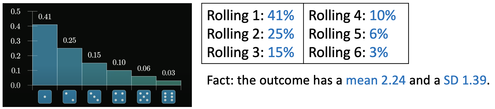
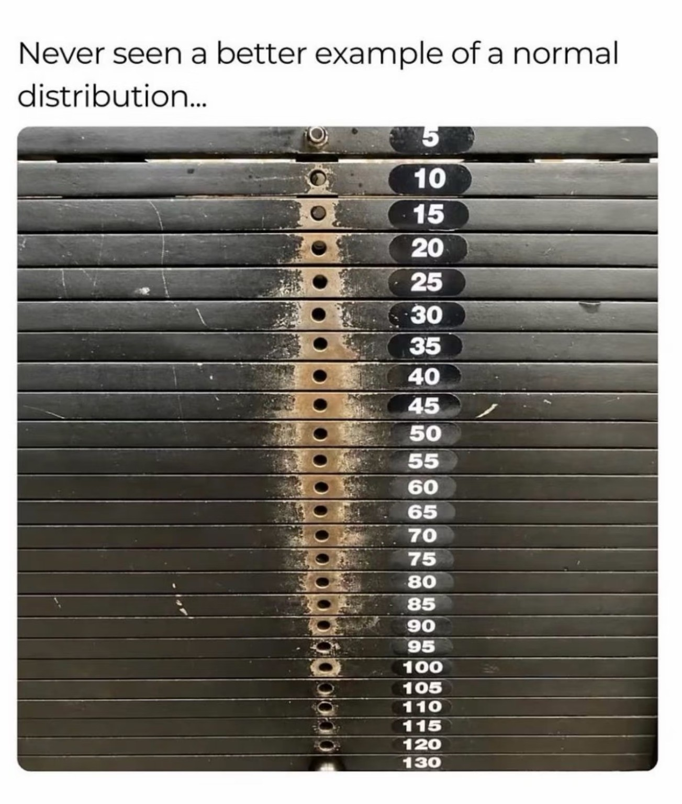

## Introduction

**Important concepts for later chapters**

- Population

- Population parameter / truth
  - Population mean
  - Population standard deviation

- Random sample

- Sample statistics / data
  - Sample mean
  - Sample standard deviation

 

[Key result of the Central Limit Theorem]{style="color:purple;"}

[(Under some assumptions) []{.blank} follows a []{.blank} distribution.]{style="color:green;"}

## Weird dice example

Review: if a score follows a normal distribution with mean = 2.24 and SD = 1.39, what is the probability that a randomly selected person has a score of 2 or lower?

 

Now, suppose you roll a **biased** dice that has the following probabilities:

{.nostretch fig-align="left" width=70%}

1. What is probability that you roll a 2 or smaller?

2. If you roll the dice **10 times** and calculate the mean of these 10 rolls, what is the probability that the mean of 10 rolls is 2 or smaller? [(Note: equivalently, this is the probability that the **sum** of 10 rolls is 20 or smaller.)]{style="color:green;"}

## SES example

Suppose the average SES of all U.S. students is 18, with a SD of 7.  In addition, we know the distribution of SES can be well-modeled by a normal distribution.

1. What is the range of SES for the majority (95%) of the students?

 

2. If you randomly select **one student**, what is the probability that the student has an SES that is below 20?

 

3. If you take a random sample of **100 students** and calculate the sample mean of these students, what is the probability that this sample mean is below 20?

## Birth month example

We represent birth month by numbers (ex: March = 3).  We can also calculate the average birth month.  For example, if Tom was born in March, Jerry was born in April, and Mary was born in August, their average birth month would be (3+4+8)/3=5.

1. If you randomly select a person, what is the probability that the person was born in September or later (i.e., birth month >= 9)?

 

2. If you take a random sample of **5 people** and calculate the average birth month of them, what is the probability that the average is >= 9?

 

3. If you take a random sample of **100 people** and calculate the average birth month of them, what is the probability that the average is >= 9?

 

## Your own example

Consider the distribution of []{.blank}.  

Suppose the average for the entire population is []{.blank} and the SD is []{.blank}.

1. If you randomly select a []{.blank}, what is the probability that []{.blank}?

 

2. If you take a random sample of 50 []{.blank} and calculate the sample mean of them, what is the probability that the sample mean is []{.blank}?

 

## Just a fun picture

{.nostretch fig-align="left" width=60%}

## Important notes

The Central Limit Theorem works when the sample size is "large enough."  How large is large enough depends on the true population distribution under consideration (e.g., income? Height?)

> In this class, we check for n>30, which is a fairly conservative cutoff.

Data is random due to the process of random sampling.  "Findings" you see in the data (e.g., large/small values of the sample mean) can happen due to random chance!

> If I see that our class average on Exam 2 is higher than the other sections, can I conclude that the hybrid format is better?

Is the data due to random chance?  The answer lies in []{.blank}.
