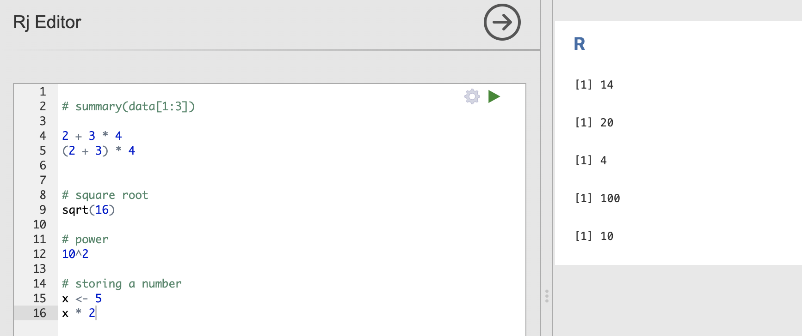

Go through this document.  It will instruct you to take two screenshots (A and B) for submission on Moodle. 


## Install Rj Editor

1. Open Jamovi.
2. Click the **Modules** button (plus sign **+**) at the top right, then **jamovi library**.
3. Under *Available*, find **Rj Editor** and click **Install**.
4. A new **R** button appears in the *Analyses* tab. Click it and choose **Rj Editor** to add a code window.

In the Rj Editor, type code in the editor box and run it with **Ctrl + Shift + Enter** (Windows) or **Cmd + Shift + Enter** (Mac), or click the green **Run** arrow. Results appear below the editor.

## Basic code (no data)

1. Type the following in the **Rj Editor**.  You can add empty lines in between (spacing, in general, does not matter in R). 

```r
2 + 3 * 4     
(2 + 3) * 4
sqrt(16)          
10^2         
x <- 5
x * 2
```

2. Run the code with **Ctrl + Shift + Enter** (Windows) or **Cmd + Shift + Enter** (Mac), or click the green **Run** arrow.

3. Comment out lines using `#` (everything after a `#`, marked in green, is ignored by R).

{width=80%}

4. Try functions related to the Normal distribution (more on this in Chapter 8).

```r
pnorm(1.96)                       # area to the LEFT of z = 1.96
1 - pnorm(1.96)                   # area to the RIGHT of z = 1.96
pnorm(60, mean = 75, sd = 8)   # P(X < 60) when mean = 75, sd = 8
pnorm(90, mean = 75, sd = 8) - pnorm(60, mean = 75, sd = 8)  # P(60 < X < 90) when mean = 75, sd = 8
qnorm(0.90, mean = 3.1, sd = 0.4)  # 90th percentile when mean = 3.1, sd = 0.4
```

5. Take [screenshot A]{style="color:red;"} of your code and output for 4 to submit on Moodle.


## Basic code (with data)

1. Open the **NELS** data in Jamovi.

2. Open an Rj Editor. Try the following code. One of the downside of Jamovi's interface is that it does not allow running selected lines of code only. To avoid generating a large chunk of output, I suggest that you type in one line at a time to run, and delete previous code before you type in the next line (i.e., your Rj Editor window should always only contain one procedure).

```r
names(data)                 # variable names
nrow(data)                  # number of students

mean(data$achmat08)         # mean 8th-grade math score
sd(data$achmat08)           # standard deviation
summary(data$achmat08)      # min, quartiles, median, mean, max

hist(data$achmat08)         # histogram
boxplot(data$achmat08  ~ data$gender)   # boxplot by group
plot(data$achrdg08, data$achsci08)   # scatterplot

tapply(data$achmat08, data$gender, mean)  # mean by gender
cor(data$achmat08, data$achmat12)         # Pearson correlation (default)
```

Notes:

- `data$achmat08` means "the variable `achmat08` inside `data`".
- If a result shows `NA`, add `na.rm = TRUE`, e.g. `mean(data$achmat08, na.rm = TRUE)`.
- Everything after `#` is a comment, and R ignores it.

3.  Take [screenshot B]{style="color:red;"} of your code and output for **one** of the above procedures to submit on Moodle.


## Notes

- **[R](https://www.r-project.org/){target="_blank"}** is a free, open-source [programming language](https://en.wikipedia.org/wiki/Programming_language){target="_blank"} designed for statistics and data analysis.

- **Jamovi** is a **[GUI](https://en.wikipedia.org/wiki/Graphical_user_interface){target="_blank"}** (graphical user interface) built on top of R. When you click an analysis in Jamovi, it runs R code behind the scenes. Jamovi's *Syntax mode* shows you that R code, and the **Rj Editor** module lets you write and run your own R code inside Jamovi.

**Example of Syntax mode.** In Jamovi, run *Analyses > Exploration > Descriptives* on any variable. Then click the three dots (**⋮**) in the top-right corner of Jamovi, and check **Syntax mode**. The results will now show the R code, such as:

```r
jmv::descriptives(
    data = data,
    vars = achmat08,
    mean = TRUE,
    sd = TRUE)
```

This code produces (mostly) the same output as the point-and-click version.