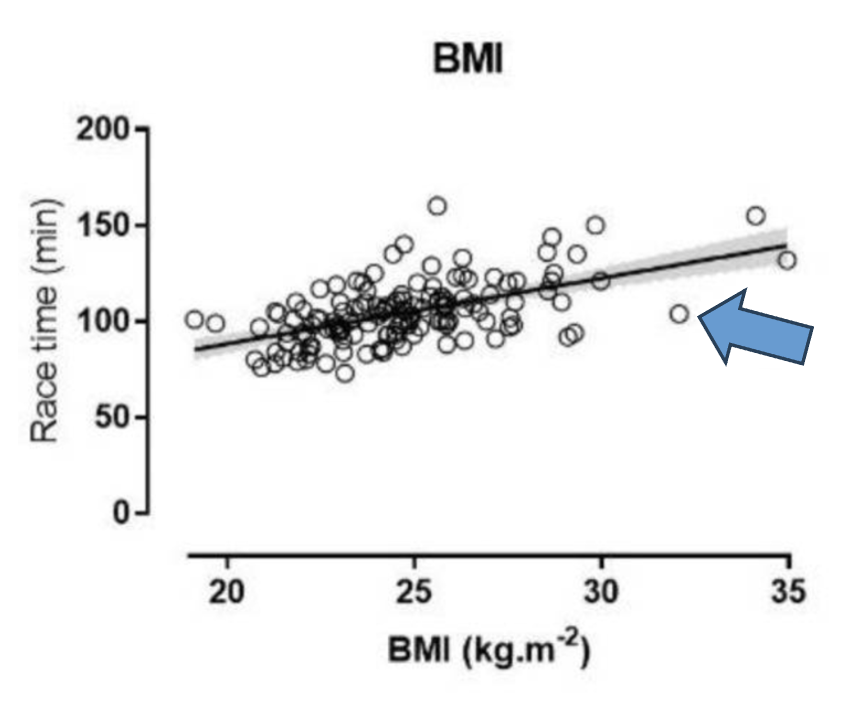

\vspace{-7em}

- Ask if you have any questions about the exam.

- Be concise in your answers. You will be penalized for adding irrelevant or incorrect information to a response.

- You don’t need to round decimals, but if you choose to, keep at least two decimals unless otherwise noted.

- You are allowed a reference sheet. Use both sides of one 8.5 by 11 inch piece of paper and put whatever you want on it. You will turn this sheet in with your exam. Be sure to put your name on it so that it can be returned to you later.

- Calculator use is permitted. You may NOT use your phone as a calculator. You will need to use your laptop, but the only programs you are allowed to have open are Jamovi and the standard Windows or Mac calculator. You need to close (not just minimize) other programs (including your web browser and all messaging apps). You are not allowed to consult any papers (other than your reference sheet), websites, books, or any person except the instructor during the exam.

- You need to download the dataset before the exam. You are not allowed to open a web browser during the exam. You must turn off WIFI on your computer.

- Cases of suspected cheating will be referred to the dean. We take cheating very seriously because it benefits student learning when students get grades that reflect what they know. For this reason, you are allowed to have at your seat only your test, your reference sheet, your computer, a calculator, and writing implements (pen or pencils). You will need to put your jacket, backpack, cell phone, smart watch and anything else you carry to class at the front of the room during the exam.

- I might tell you where to sit, or move your seat, during the exam.

The dataset used for the exam is **GSS_SP2026.sav** (same as exam 1).  This dataset is gathered from the General Social Survey 2024, a large scale survey conducted by NORC at the University of Chicago .  The levels of measurement in Jamovi are not set correctly, so you need to judge for yourself.  Sometimes, the level of measurement is subjective or controversial, and the relevant question will tell you what to do.

**Note 1:** the data is set up such that any value between -100 and -10 is automatically treated as a missing value.  You don’t need to do anything about these as Jamovi knows how to handle them (for instance, they are excluded from calculations of any statistics).

**Note 2:** these three variables are similar: `dem10fut`, `dem10pst`, `demtoday`. Make sure that you are using the correct one as specified in relevant questions.

\newpage

**1. (20 points)** In the following problems, you are asked about the relationship between pairs of variables in the data set.

\medskip
**(a)** The variables `dem10fut` and `dem10pst` measure people’s assessment to “How well will democracy work in America in ten years” and “How well did democracy work in America ten years ago,” on a scale of 0 (very poorly) to 10 (very well). Treat both variables as Numeric variables. The relationship between `dem10fut` and `dem10pst` can best be described by the Pearson / Spearman (circle one) correlation coefficient. The value of the correlation coefficient is ________. Is there a relationship between the two variables? If so, state the direction and strength of the relationship and provide a one-sentence interpretation of the relationship in the context of the problem.

\medskip
**(b)** The relationship between `income` (total family income) and `degree` (respondent's highest degree) can best be described by the Pearson / Spearman (circle one) correlation coefficient. The value of the correlation coefficient is ______. Is there a relationship between the two variables? If so, state the direction and strength of the relationship and provide a one-sentence interpretation of the relationship in the context of the problem.

\medskip
For the following open-ended problems, report the name and value of at least one appropriate statistic to support your conclusion.  When describing the relationship, interpret the relationship in context using terms that someone who has not taken statistics could understand (for example, “there is a positive relationship” is not sufficient) and avoid causal language.  If you are using a correlation coefficient, be sure to indicate the direction and strength of the relationship.

\medskip
**(c)** Is there a relationship between `othlang` (can respondent speak language other than English/Spanish) and `dem10fut` (how well will democracy work in America in ten years, treat as a Numeric variable)?

\medskip
**(d)** Is there a relationship between `othlang` (can respondent speak language other than English/Spanish) and `income` (total family income)?

\newpage

**2. (13 points)** Create a contingency table for the variables `sex` and `gendtech` (“Are women or men benefiting more from digital tech”).

\medskip
**(a)** Use the table to fill out the blanks.

- i. The count (NOT percentage) of male and female respondents, respectively: _______________
- ii. Among male respondents, what percent believe “men are benefitting more than women”? _____%
- iii. Among male respondents, what percent believe “neither men nor women are benefitting”? _____%
- iv. Among female respondents, what percent believe “men are benefitting more than women”? _____%
- v. Among female respondents, what percent believe “neither men nor women are benefitting”? _____%

\medskip
**(b)** Is there a relationship between `sex` and `gendtech`? You must select two numbers from (a) to draw a conclusion. If there is a relationship, describe the relationship in the context of the problem.

\medskip
**(c)** Can we use a correlation coefficient to draw a conclusion between `sex` and `gendtech`? Why or why not? Briefly explain.

\newpage

**3. (10 points)** The following questions are based on the variable `childs` (number of children, treat it as a Numeric variable).

\medskip
**(a)** If a respondent has no children (i.e., `childs` = 0), what would be the corresponding z-score? Perform this calculation by hand (not using Jamovi). You must show your work to get full credit.

\medskip
**(b)** What would be the value for `childs`, if the corresponding z-score is 1.35? Perform this calculation by hand (not using Jamovi). You must show your work to get full credit.

\newpage

**4. (25 points)** As used in Question 1, the variables `dem10fut` and `dem10pst` measure people’s assessment to “How well will democracy work in America in ten years” and “How well did democracy work in America ten years ago” (0=very poorly to 10=very well; both treated as Numeric variables). Perform a regression analysis that uses `dem10pst` to predict `dem10fut`. For interpretations, you can use the variable names directly (e.g.: “when `dem10pst` increases by 1….”)

\medskip
**(a)** Write down the regression equation.

\medskip
**(b)** Report the value of the intercept.  Interpret the value of the intercept in the context of this problem using language that someone who hasn’t taken statistics would understand or indicate why it would not be meaningful to do so.

\medskip
**(c)** Report the value of the slope and interpret it in the context of this problem using language that someone who hasn’t taken statistics would understand or indicate why it would not be meaningful to do so.

\medskip
**(d)** Find the person with ID 2 (should be in the second row if you have not rearranged the data). Calculate the predicted value of `dem10fut` for this person.

\medskip
**(e)** Does the model overpredict or underpredict the value of `dem10fut` in (d)? Calculate the residual.

\newpage

**5. (20 points)** You do not need Jamovi for this question. The following plot is from an article “Predictors of half-marathon performance in male recreational athletes.” It shows the correlation between half-marathon race time (in minutes) and body mass index (`BMI`). The regression line is shown on the graph.

{width=60%}

\medskip
**(a)** For a male recreational runner with a `BMI` of 25, what is the predicted `race time`? Give a rough estimate from the graph and indicate on the graph how this estimate is obtained.

\medskip
**(b)** There is a data point indicated by an arrow.  Does the regression model over- or under-predict for this data point?  Briefly explain.

\medskip
**(c)** The slope of the regression line is 3.4 (given in the article).  Provide an interpretation of this value in the context.

\medskip
**(d)** Which one of the following is true regarding the intercept of the regression line? Choose one.

- i. Not interpretable since `race time` cannot be 0.
- ii. Not interpretable since `BMI` cannot be 0.
- iii. It is a value between 50 and 100.
- iv. It can be interpreted as the predicted `race time`.

\newpage

**6. (12 points)** You do not need Jamovi for this question.  The following information are from the same article quoted in Question 5.

Few research has been conducted on predictors of recreational runners' performance, especially in half-marathon running. The purpose of our study was (a) to investigate the relationship of `half-marathon race time` with training, anthropometry and physiological characteristics, and (b) to develop a formula to predict `half-marathon race time` in male recreational runners.

Half-marathon race time correlated with physiological, anthropometric and training characteristics, with the faster the runner, the better the score in these characteristics (e.g., `VO2max`, r = - 0.59; `BMI`, r = 0.55; `weekly running distance`, r = -0.53, p<0.001). `Half-marathon race time` was related to and could be predicted by `BMI`, `VO2max` and `weekly running distance`. Based on these relationships, a prediction formula for `race time` was developed providing a practical tool for recreational runners and professionals working with them.

\medskip
**(a)** Which type of runners tend to be faster (i.e., lower `half-marathon race time`)? Choose one from each of the blanks:

Runners with (higher / lower) `VO2max`; runners with (higher / lower) `BMI`; runners with (higher / lower) `weekly running distance`.

Briefly explain how you can tell.

\medskip
**(b)** The article says “`Half-marathon race time` was related to and could be predicted by `BMI`, `VO2max` and `weekly running distance`.” Which of the following statement is true? Choose one.

- i. `BMI`, `VO2max`, and `weekly running distance` are the dependent variables.
- ii. `Half-marathon race time` is the dependent variable.
- iii. The prediction formula must be based on a simple linear regression.
- iv. When predicting `half-marathon race time`, residual values can only be positive.

\medskip
**(c)** Based on these findings, can we conclude that a change in `BMI` will directly cause a change in running performance? Briefly explain.
